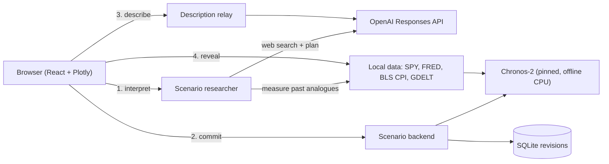

# 

**Ask "what if?" about the US stock market and watch the answer sail across the chart.**

You type a dated hypothetical, such as *"What if Iran halted oil exports in June 2025?"*. The app researches it, turns it into measurable economic assumptions, and forecasts how the S&P 500 (SPY) might have moved. Add up to three linked prompts, go back and change an earlier one, and watch everything after it redraw. Then reveal what the market actually did.

Built in 24 hours at **HackTheBurgh XIII** (7–8 November 2026).

---

## Contents

- [What it does](#what-it-does)
- [How it works](#how-it-works)
- [The model (and what we did not do)](#the-model-and-what-we-did-not-do)
- [Results](#results)
- [Tech stack](#tech-stack)
- [Running it](#running-it)
- [Configuration](#configuration)
- [Tests](#tests)
- [Project layout](#project-layout)
- [Known limitations](#known-limitations)
- [Data, models and credits](#data-models-and-credits)
- [How we worked](#how-we-worked)
- [Team](#team)
- [Further reading](#further-reading)

---

## What it does

The app plays like a pixel-art voyage.

1. **Set sail.** On the start screen you choose how many prompts your journey will have and type your first "what if". Press Tab to use the suggested example.
2. **Forecast.** The chart draws real SPY history up to your event, then a forecast median with a shaded 10–90% range. A pink dashed marker labels each prompt.
3. **Weather follows the market.** Behind the chart, a pirate ship sails a pixel sea. A forecast gain brings sun; a loss brings rain, lightning and heavy swells. The ship moves one leg further toward the far dock with each prompt.
4. **Read the scrolls.** Every prompt gets a parchment note. Click it to unroll the full explanation: the researched hypothesis, cited sources, comparable past events, and a plain-English description written after the numbers were fixed.
5. **Rewrite history.** Click an earlier prompt's marker, edit it, and resubmit. Later prompts keep their identity and are re-forecast on top of the changed past.
6. **Reveal reality.** "Reveal actual history" overlays what SPY really did over the forecast period. The real prices are never fed to the model.
7. **Captain's log.** When the journey is complete, "End journey" shows a summary of every leg's gain or loss and the net result.

Accessibility: the app works by keyboard throughout, uses a native `<dialog>` for "How to play", and honours reduced-motion settings (static sea, no lightning, no line animation).

## How it works



One FastAPI app serves four steps. The browser only ever talks to it, and API keys never leave the server.

1. **Interpret** (`POST /api/timelines/{id}/interpret`). Two strict-JSON OpenAI calls:
   - **Research:** with web search, it extracts the event, its date, the forecast horizon (20 trading sessions by default), a hypothesis, cited sources, and up to five earlier comparable events.
   - **Plan:** turns that research into numeric "driver" paths for the inputs the model understands: Fed funds rate, WTI oil, VIX and CPI. Each driver has a value, a ramp/duration/recovery shape, and a stated basis (user assumption, historical analogue, or model hypothesis).

   Between the two calls, the backend measures what the market *actually* did after each comparable event, using local data. Python then validates the plan: every feature exists, every citation was really returned by the search tool, and every analogue claim has a measured window behind it.
2. **Commit** (`POST …/commit`). There is no LLM call here. Chronos-2 forecasts two paths in five-session blocks: the **scenario** (with the planned driver paths) and a **baseline** (inputs held at their last values). The result is saved as an immutable, idempotent revision.
3. **Describe** (`POST …/revisions/{n}/description`). After the chart is drawn, the browser sends back that prompt's exact forecast points. The server checks they match the saved revision, then asks OpenAI for a plain-English description. Prose can never change a number.
4. **Reveal** (`GET …/revisions/{n}/reveal`). This returns real SPY levels for the forecast dates from a separate reader, kept out of inference.

**Editing the past.** Every add or replace creates a new revision. Prompt IDs and numbers are stable. In scenario mode the whole simulated run is recomputed on each edit, and only real history before the earliest prompt is frozen. The frontend applies full or partial ("suffix") updates by revision and ignores stale responses.

## The model (and what we did not do)

**We did not train or fine-tune a model.** Every model runs with fixed, pretrained weights:

| Role | Model | Notes |
|---|---|---|
| Numbers | [`amazon/chronos-2`](https://huggingface.co/amazon/chronos-2), revision `29ec376…`, `chronos-forecasting==2.3.2` | Zero-shot time-series forecasting with covariates. Runs offline on CPU (4 threads) and returns quantiles 0.1 / 0.5 / 0.9. |
| Research, planning, narration | OpenAI Responses API | Verified with `gpt-5.6-sol`; uses strict JSON schemas, server-side only. |
| CPI parser fallback (research mode only) | `qwen3.5:9b` via Ollama | Local, used only if OpenAI is unavailable. |

The machine-learning work was everything around the model:
- building clean, hashed data snapshots;
- aligning SPY prices with macro inputs, using only values that were public at the time;
- turning researched events into covariate paths;
- validating LLM output against evidence;
- building empirical baselines;
- an honest chronological evaluation.

SPY is indexed to 100 on 7 March 2022. FRED inputs are lagged two days and carried forward at most seven, and CPI applies from its original BLS publication time.

## Results

**Chronological backtest (CPI research mode).** We ran 18 CPI release dates from January 2024 to June 2025. Each was frozen one second before publication and forecast five sessions ahead, with actual prices loaded only for scoring:

| Engine | Scored / attempted | Mean absolute index error | 10–90% band coverage |
|---|---:|---:|---:|
| Chronos-2 | 17 / 18 | 1.60 | 78.8% |
| Empirical reference (past CPI windows) | 17 / 18 | 1.43 | 72.9% |
| Empirical analogue (similar CPI surprises) | 6 / 18 | 1.21 | 76.7% |

On these folds **Chronos-2 did not beat the simple reference baseline on error**, though its bands covered the real outcome slightly more often. The analogue engine was scored on a different subset of folds, so this is not a leaderboard. These are descriptive diagnostics, not a leakage-free backtest: the pretrained weights and current-vintage data may contain later information.

**Live scenario checks** (final medians, index points):

| Scenario | Baseline | Scenario |
|---|---:|---:|
| Iran halts oil exports, 11 Jun 2025, 20 sessions | 144.26 | 142.25 |
| All US import tariffs removed for 30 days, 3 Apr 2025, 10 sessions | 134.20 | 135.75 |

Timing: the first Chronos call takes about 2.2 s and warm calls about 0.24 s. An uncached scenario interpret can take a few minutes because it runs two sequential web-research calls; validated plans are cached.

## Tech stack

| Layer | Tools |
|---|---|
| Frontend | React 19, TypeScript, Vite, Plotly.js, VT323 pixel font, hand-drawn canvas pixel sea |
| Backend | Python 3.10+, FastAPI, Pydantic v2, SQLite (WAL) |
| Data | pandas, NumPy, PyArrow (hashed Parquet snapshots), exchange-calendars (XNYS) |
| Models | Chronos-2 (PyTorch, Transformers), OpenAI Responses API with web search, optional Ollama |
| Contracts | Pydantic → JSON Schema / OpenAPI → generated TypeScript types |

## Running it

**Requirements:** Python 3.10+, Node 22.18+. The real-data modes also need the local data files described below, which are not in the repo.

### 1. UI only (no backend, no keys)

The fastest way to see the app. It uses an in-browser mock with a clearly labelled synthetic 1980–2026 path.

```sh
cd web
npm install
npm run dev        # http://127.0.0.1:5173
```

### 2. UI + synthetic fixture API

This exercises the real HTTP contract with deterministic synthetic data. No model downloads or keys are needed.

```sh
python3 -m venv .venv
.venv/bin/pip install -r requirements-contracts.txt
.venv/bin/python -m uvicorn api.fixture_app:app --host 127.0.0.1 --port 8000

# second terminal
cd web && VITE_API=server npm run dev
```

Interactive API docs are at http://127.0.0.1:8000/docs.

### 3. Full demo: scenario mode (what we showed the judges)

**a. Install the forecasting stack and download the pinned Chronos-2 weights once:**

```sh
python3 -m venv .venv
.venv/bin/pip install -r requirements-forecast.txt
.venv/bin/python tools/chronos_smoke.py download
.venv/bin/python tools/chronos_smoke.py forecast --offline   # optional sanity check
```

**b. Put the input data under `data/local/raw/`.** This folder is git-ignored; never commit it.

| Path | Contents |
|---|---|
| `hf/SPY_raw_1min.parquet` | SPY IEX minute bars, 7 Mar 2022 – 6 Nov 2026 ([HF Data Library](https://hfdatalibrary.com/)) |
| `fred/DFF.csv`, `fred/DCOILWTICO.csv`, `fred/VIXCLS.csv` | FRED exports; first column `observation_date`, second named after the series |
| `bls/`, `bls-expanded/` (optional) | Original BLS CPI release archives (`tools/download_cpi_archives.py`) |
| `gdelt/` (optional) | GDELT daily event exports; small archives are also fetched on demand |

**c. Create `.env.local` with your server-side OpenAI settings** (see `.env.example`). Never put keys in `VITE_*` variables.

```sh
OPENAI_API_KEY=sk-...
OPENAI_MODEL=gpt-5.6-sol    # any model your project can use with web search
```

**d. Start the backend, then the UI:**

```sh
.venv/bin/python tools/serve_scenarios.py --env-file .env.local --model gpt-5.6-sol --port 8772

# second terminal
cd web && VITE_API=server BACKEND_URL=http://127.0.0.1:8772 npm run dev
```

The launcher reads the env file without executing it, runs Chronos offline, and creates a fresh SQLite database each time. Pass `--database <file>` to resume an old one.

### Optional: CPI research mode and evaluation

This is a bounded mode for monthly CPI scenarios at the 11 June, 15 July and 12 August 2025 releases (values from −2% to 2%):

```sh
.venv/bin/python tools/prepare_market_data.py --cpi-directory data/local/raw/bls-expanded
.venv/bin/python tools/serve_research.py --env-file .env.local --port 8771
.venv/bin/python tools/evaluate_market.py --dataset-version spy-8c865e107520d2cdab66
```

## Configuration

The main server settings are below; the full list is in [`.env.example`](.env.example). `api.app` does not load `.env` files itself; the launchers do.

| Variable | Purpose |
|---|---|
| `APP_MODE` | `fixture` (default, synthetic), `research` (bounded CPI) or `scenario` (open-ended events) |
| `OPENAI_API_KEY`, `OPENAI_MODEL` | Server-side only. Used for research, planning, CPI parsing and narration |
| `SCENARIO_TIMEOUT_SECONDS` | Per research call. Default 90, maximum 180 |
| `OPENAI_DESCRIPTION_TIMEOUT_SECONDS` | Narration relay timeout. Default 20 |
| `PARSER_PROVIDER` | `deterministic`, `auto` (OpenAI then Ollama) or `ollama`. Research mode only |
| `OLLAMA_BASE_URL`, `OLLAMA_MODEL` | Local fallback, `qwen3.5:9b` |
| `DATASET_VERSION` | Pinned snapshot for research mode, e.g. `spy-8c865e107520d2cdab66` |
| `DATA_DIR`, `SQLITE_PATH` | Local data and database locations |

| Frontend (Vite) | Purpose |
|---|---|
| `VITE_API=server` | Use the real HTTP API instead of the in-browser mock |
| `BACKEND_URL` | Dev proxy target for `/api`. Default `http://127.0.0.1:8000` |
| `VITE_BACKGROUND_ASSET` | Optional GIF in `web/public` to replace the pixel sea |

## Tests

```sh
# Contracts and fixtures
.venv/bin/python tools/export_contracts.py --check
.venv/bin/python tools/build_example_fixtures.py --check
.venv/bin/python tools/check_fixtures.py

# Backend: durable store, replay, parsers, descriptions, scenarios, market adapter
.venv/bin/python -m unittest discover -s tests -p "test_*.py" -v

# Frontend contract and UI logic
node --test tests/frontend-contract.test.mjs tests/web-ui.test.mjs
cd web && npm run typecheck
```

The market and research-HTTP suites skip themselves unless `requirements-market.txt` is installed.

## Project layout

```
api/        FastAPI app, durable revision store, replay, scenario research, parsers, narration relay
data/       Market/macro snapshot builders, GDELT archive, separate "reveal" reader
training/   Chronos-2 adapters, empirical baselines, chronological evaluation
web/        React + Vite frontend (chart, composer, scrolls, pixel sea, end screen)
shared/     Generated JSON Schema / OpenAPI, synthetic fixtures, three-prompt journey
tools/      Launchers, data preparation, evaluation, contract export, team board script
tests/      Python unittest suites and Node frontend tests
docs/       Architecture, wire contract and handover notes
```

The canonical API schema is `api/contracts.py`. Regenerate `shared/*.json` and `web/src/generated/contracts.ts` from it rather than editing them by hand.

## Known limitations

- **Three prompts against the real backend.** The start screen offers journeys of 1–7 prompts, which the mock supports. The real backend accepts three and refuses a fourth with `prompt_limit`.
- **Data starts in March 2022.** The UI's examples mention 1980–2026, but real forecasts need at least 20 trading sessions of SPY history before the event. Earlier dates return `data_coverage`. Forecasts are capped at 65 sessions.
- **No delete in server mode.** Deleting prompts and the backend journey summary exist only in the mock. Against the real API you replace prompts instead, and the end screen computes the summary in the browser.
- **Impact rows are empty.** The planned ranked industry exposures (e.g. "✈️ Airlines +1.2%") are not produced by the backend yet.
- **Scenario mode has no held-out evaluation.** Only the CPI mode was backtested. Scenario forecasts show association, not causation.
- **Current-vintage data.** FRED values are today's vintages with a lag, not true point-in-time ALFRED vintages, and SPY comes from one exchange (IEX) as a daily close proxy.
- **No research fallback.** If OpenAI or web search fails in scenario mode, nothing is saved and the user retries.

## Data, models and credits

- **SPY prices:** IEX HIST via the [HF Data Library](https://hfdatalibrary.com/), compilation CC BY 4.0, subject to provider terms and the [IEX data notice](https://www.iex.io/legal/hist-data-terms). Used for educational purposes.
- **Macro inputs:** [FRED](https://fred.stlouisfed.org/), Federal Reserve Bank of St. Louis (DFF, DCOILWTICO, VIXCLS).
- **CPI:** original release archives from the [U.S. Bureau of Labor Statistics](https://www.bls.gov/).
- **Events:** [GDELT Project](https://www.gdeltproject.org/) daily event exports, used as dated context only.
- **Forecasting model:** [Chronos-2](https://huggingface.co/amazon/chronos-2) by Amazon Science, Apache 2.0.
- **Language models:** OpenAI (research, planning, narration); Qwen 3.5 via [Ollama](https://ollama.com/) (optional fallback).
- **Frontend:** [Plotly.js](https://plotly.com/javascript/), [VT323](https://fonts.google.com/specimen/VT323) font (SIL OFL).

Nothing here is financial advice. Forecasts are model output conditioned on hypothetical assumptions.

## How we worked

We were a team of four. Chohan and Orion built the frontend together; Aashna and Aditya built the backend and the machine-learning pipeline together. There was no hard divide. We helped each other across the stack and paired on AI prompts throughout, using Codex and Claude Code as coding assistants.

To coordinate, we used a pinned GitHub issue as a message board, a small notification-only listener (`tools/board`), and shared agent rules in [AGENTS.md](AGENTS.md): humans choose the work, and agents never merge, push or post on their own. The frontend and backend were developed against one shared, generated API contract, with a synthetic fixture server so both halves could move in parallel before the real model was ready.

## Team

| Name | GitHub |
|---|---|
| Aashna | [@aashnakulsh](https://github.com/aashnakulsh) |
| Aditya | [@ADI-GHH](https://github.com/ADI-GHH) |
| Chohan | [@yimchohan](https://github.com/yimchohan) |
| Orion | [@wthoreo](https://github.com/wthoreo) |

## Further reading

- [docs/architecture.md](docs/architecture.md): full design, replay rules and what was implemented
- [docs/frontend-backend-contract.md](docs/frontend-backend-contract.md): wire contract
- [docs/general-scenario-handover.md](docs/general-scenario-handover.md): scenario mode in depth
- [docs/real-data-adapter.md](docs/real-data-adapter.md): data audit and evaluation
- [docs/continuous-cpi-demo-handover.md](docs/continuous-cpi-demo-handover.md): CPI research mode
- [docs/durable-backend.md](docs/durable-backend.md): revision store and idempotency
