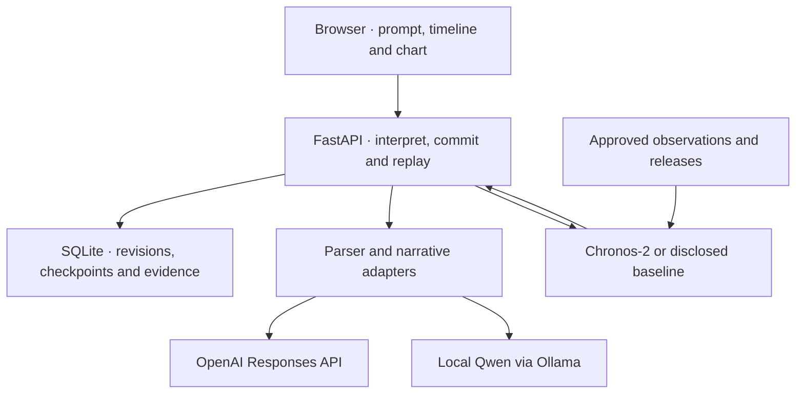

# US Market What If? — HackTheBurgh XIII architecture

**Team implementation agreement · 7 November 2026 · one submission.** A visitor writes a dated “what if”, watches a US equity forecast draw across a timeline, and clicks an earlier prompt to change the subsequent story. A timeline holds up to `MAX_PROMPTS` dependent prompts (currently **7**, the longest journey the start screen allows); the shared acceptance example uses three. A usable release has one US market proxy, one measured economic input, an editable timeline, and a forecast that a judge can compare with an actual historical outcome.

| If you are implementing… | Start here | Coordinate with |
|---|---|---|
| Layout, composer, markers, animation or settings | §2, §3 and §5 | Chohan and Orion |
| Branch state, endpoints, LLM providers or deployment | §3–§6 | Aashna |
| Prices, releases, Chronos-2, evidence or evaluation | §4, §6 and §7 | Aditya and Aashna |
| Integration, judging or release | §1, §8 and §9 | All four |

## 1. Boundaries and ownership

Use one React/TypeScript/Vite frontend with Plotly.js, one Python FastAPI backend, one local SQLite database with FTS5 search, and versioned Parquet inputs. The browser sends commands and displays results. The backend owns dates, prompt meaning, timeline ordering, forecast numbers, evidence and numerical attribution. Package the frontend and backend together for judging. The repo and issue below identify the team's coordination point.

| Person and tool | Ownership for this build | Handoff |
|---|---|---|
| **Aashna** · `aashnakulsh` · Codex | Team lead. Own `api/` routes, replay coordinator, SQLite revisions, provider adapters, shared config, integration and PR review. Coordinate data/model choices with Aditya. | Publish the wire contract and one synthetic response first. Integrate all four workstreams and own sign-off. |
| **Aditya** · `ADI-GHH` · Codex | Own `data/` and `training/`. Build the source manifest, session calendar, dated evidence, Chronos-2 adapter, comparable-event baseline and evaluation. Own the model-facing part of `api/` with Aashna. | Return a versioned forecast result, an unsupported result, and a fixture with a known answer for the edit demonstration. |
| **Chohan** · `yimchohan` · Codex | Own the `web/` chart, timeline ticks, markers, interval shading, settings, playback and partial redraw. | Consume the run response and emit a selected prompt ID or playhead date. Coordinate the CSS/layout boundary with Orion. |
| **Orion** · `wthoreo` · Claude Code CLI | Own the `web/` screen shell, composer, selection/edit state, translucent narrative, impact list, background and responsive layout. | Wire commands and errors to Aashna's API and pass committed chart state to Chohan. |

This is the proposed split inside the flexible focus areas supplied by the team. Keep each person's optional sandbox under `practice/<GitHub login>/` with the exact casing above. Use shared paths for integrated code. Aashna owns changes to the shared response shape. [Team repository](https://github.com/aashnakulsh/TeamRelay-Hackathon) · [Team message board, issue #1](https://github.com/aashnakulsh/TeamRelay-Hackathon/issues/1)



## 2. Frontend behavior

| Surface or action | Required behavior |
|---|---|
| Game flow | The app is a voyage game: **start screen → voyage (one prompt per leg) → end screen**. Each prompt is one leg of the journey. |
| Start screen | A zoomed-in, animated pixel scene of the pirate ship moored at the departure dock (black before it draws). Center one long, keyboard-focused prompt input horizontally, over the water below the ship. Give it an accessible label and a rotating situational example placeholder (see Free-text prompts). Beside it, a **required** “Prompts” picker (1 to `MAX_PROMPTS` = 7) sets the journey length, and the button reads **“Start journey”**; it stays disabled until text and a length are chosen. Enter submits, Shift+Enter adds a line, and Tab in the empty box fills in the shown example (with text present, Tab moves focus as usual). The game title “US Market What If?” sits large in yellow pixel lettering at the top of the start screen and in the voyage header. **Fonts and buttons:** decorative, low-stakes text (titles, labels, hints, notices, buttons, scrolls) uses the pixel font; numbers, chart details and typed input keep the sans font. Primary buttons (“Start journey”, “Continue journey”, “Reveal/Hide actual history”) are the title yellow with brown text. The label uses the pixel font. A **“How to play”** button (top right) opens a modal pixel-scroll pop-up. It explains: choose 1–7 prompts; ask “what if” a historical or made-up event happened between 1980 and 2026; name a historical event and the backend finds its date; include the year for a made-up event; gains bring sun and losses bring storms; that a short note appears for each prompt and clicking it unrolls the full description; how to replace or delete a prompt; Tab to use the example; and that the voyage ends with the captain's log. It is a native `<dialog>`: focus is trapped, and Escape, “Got it” or a click outside closes it. |
| End screen | When the active prompts reach the chosen length, wait for the last leg to draw and the ship to reach the finishing dock (≈2.6 s; immediate with reduced motion), then switch to a zoomed-in pixel scene of the ship at the finishing dock. Its weather follows the whole voyage's net change. On the left, a giant pixel scroll shows the backend's journey summary (§5 `summary`): headline, net result, narrative and each leg's gain/loss. Focus moves to its heading. “Sail again” starts a new journey on a fresh timeline; “Review the chart” returns to the voyage view, where a “Captain's log” button reopens the scroll. Deleting a prompt there reopens a leg; reaching the length again shows the end screen again. |
| First submission | Transition to the workspace immediately. Preserve the submitted text while the API responds. Center the same composer near **80% of viewport height** on desktop. Top to bottom: graph and narrative overlay, timeline scale, composer, impact list. A narrow or short screen uses normal vertical flow with scrolling and keeps the list below the composer. |
| Timeline and settings | Begin with a **1980–2026** overview. Settings allow the visible start and end years to change. The scale, scrubber and chart share one time domain. A range change pans/zooms the viewport. Scrubbing moves a playhead and reads cached values; it does not submit prompts or invoke either model. |
| Years, lines and intervals | Grey the specified year, or every included year for an interval, on the scale. For a single event draw one grey vertical dashed line through the chart with `Prompt (x+1)`,where x stands for the 0th indexed and the xth number of prompt, at its top. For an interval draw dashed start/end boundaries and a subtle grey band with one label anchored at the start. Preserve the semantic year even when the trading session is shifted. Supply an accessible button for each marker, stack overlapping labels, and include the full date/span in its tooltip. |
| Graph | Render backend-supplied observed history through the fork, followed by a visually distinct **simulated median** and shaded range. Label the target, units, observed/simulated boundary, and model used: these chart details sit in a small white vertical legend pinned to the bottom-left corner of the screen (in flow under the chart below 1200 px wide). The 10–90% range is shaded pink for contrast with the blue median and the sea. On explicit reveal, overlay the actual subsequent path in a third style. Keep the reveal response out of forecasting inputs. |
| Animation | On the first successful run, animate the full visible available line left-to-right. On an add or replacement, retain all cached points strictly before `changed_from` and animate only the replacement suffix. Use the server's point order and existing points for the drawing effect. Keep the same y-axis during the animation, cancel older animations on a new revision, and allow skip/reduced motion. Planning defaults are 1.2 s for a full draw and 0.7 s for an edit. [Plotly animation reference](https://plotly.com/javascript/animations/) |
| Free-text prompts | The composer accepts any wording; the user may name any day, month, year or year range inside the sentence. Placeholder examples are **situational** (everyday events, no jargon or figures), e.g. “What if the U.S. bombed Iran in 2015?” or “What if the 2001 IMF crisis didn't happen?”. Ten are kept in `web/src/features/workspace/examples.ts` and swapped at random every 5 s while the box is empty. Wording with some figures (“6% inflation”) is intermediate; acronyms plus figures (“Set June 11 CPI to 0.4%”) is technical. All three must work. The browser sends the raw text only. The server-side OpenAI parser (Qwen fallback) translates it into the canonical instruction, including the dates. **Dates:** events must fall between 1980 and 2026. For a **historical event** named without a date (“What if Lehman Brothers had been rescued?”), the backend determines when it occurred from its own knowledge and evidence, and returns `needs_clarification` only if that is ambiguous. A **hypothetical event** must state its year; if it doesn't, return `needs_clarification` asking for one. The frontend does not resolve historical dates. Until that parser exists, a temporary in-browser mock (`web/src/api/mockApi.ts`) guesses dates and draws a labeled synthetic 1980–2026 path. |
| Selecting and replacing | Clicking a marker (or its note) selects its stable prompt ID, scrolls the composer into view, focuses/highlights it, loads the old text and labels the action “Replace prompt n”, where n is the prompt number. Submitting replaces that active prompt. Cancel/Escape, or a click on empty space that is not a button, link, input or the composer, returns to “Continue journey” and clears the selection. Keep unsent text on a failure; change the graph only on a successful commit. A keyboard user can perform the same sequence. |
| Deleting a prompt | Hovering a marker label, or focusing it from the keyboard, shows a small × at the label's top-right; on touch screens the × shows on the selected marker. Pressing × deletes that prompt through the delete endpoint (§5). The other prompts keep their IDs and permanent numbers. The graph changes only on success and redraws from the deleted prompt's effective start. Deleting the selected prompt also clears the selection. |
| Prompt limit | `MAX_PROMPTS` (currently **7**) caps the journey length and the active prompts per timeline; the backend reports it as `capabilities.max_prompts`. The chosen length is the per-journey cap. At the cap, “Continue journey” explains that a prompt must be deleted or replaced, keeps the text and makes no API call. Replacing stays available. The composer label shows “prompt k of n”. |
| Description notes | Styled as **pixel scrolls**: dithered parchment, a hard 4 px notched border, stepped wooden rods top and bottom, dark-brown ink in the bundled pixel font VT323 (`@fontsource/vt323`, OFL, works offline), centered lowercase title (“prompt n”) and a typed divider line (`=-=-`, `·x·x`, `.....`, `._.~`). **No prompt selected:** a centered row of small notes, one per prompt in timeline order, slightly tilted and overlapping, each with the prompt text, date and gain/loss; clicking a note selects that prompt. **A prompt selected:** one wide note centered above the graph with the market summary, direct and indirect markets/products, the resolved scope, and a labeled political-economic hypothesis with clickable dated sources. Notes sit in normal flow above the graph; the graph takes only the remaining height, so notes never cover markers, the plot or the composer. On mobile the row scrolls sideways inside itself. |
| Impact list | Directly **below the composer**, display 3–5 ranked bullets of the most affected industries when supported. Format signed quantified rows like `✈️ Airlines +1.2%`, with measure, reference and horizon visible in text or an accessible detail. Show fewer verified entries where necessary. Use a qualitative label for an exposure that has no defensible value. See §6. |
| Background | Workspace background is a pixel-art sea voyage (`web/src/features/workspace/PixelSea.tsx`) with a pirate ship. **Weather:** compare the shown prompt's forecast segment (selected, else last changed) terminal median with the level entering it. Any net gain is sunny; any net loss is stormy, with rain, darker sky, larger waves and spray. Bigger moves give stronger weather. Flat or unknown is calm. **Voyage:** each prompt is one leg; the ship sails from the left dock toward the right dock as prompts are added (`prompts / chosen length`). **Sea level and ship size:** the water surface sits exactly on the chart's y = 2000 line (`SEA_LEVEL` in `Chart.tsx`, published as `data-sea-y`). The ship is scaled so its mast tip meets the y-axis maximum (the plot's top edge, `data-top-y`), and it floats on the water. The chart keeps its size; only its y scale adjusts, and the y-axis maximum is always at least 1.25 × `SEA_LEVEL` (2500), so the sea line and the ship always fit on the plot. The header shows “Voyage k / n · Sunny/Stormy/Calm”, and the scrolls keep a textual gain/loss and sign. Lightning flashes are capped at 25% white. Reduced motion draws a static frame with no lightning. A team-supplied local GIF can still replace the scene (`VITE_BACKGROUND_ASSET`). The start and end screens use the same scene, zoomed in on the docks. |
| Loading or unsupported | Keep the last committed graph visible and show a small pending state for the new request. For the very first prompt, show an empty graph frame and progress or a clarification. Explain a coverage gap, ambiguous prompt or unsupported intervention in place. Never animate invented history or a previously rejected edit. |

## 3. Timeline and replay rules

**Identity.** Each committed prompt has a stable `id`, permanent `display_number`, original text, date/span, canonical operation, units, evidence IDs and creation order. Every accepted write creates an immutable revision and atomically updates the active timeline. Replacing a prompt removes its old version from the active view. Its old version remains in the previous revision for comparison. Marker IDs/numbers survive date reordering.

**Dates and units.** Keep original requested dates, resolved trading sessions and timezone separately. US equities use America/New_York and the selected exchange calendar. Interpret a bare year as January 1–December 31 for lookup/highlighting. A single-year prompt produces one marker at the first relevant event/session, with the year grey. An explicit multi-date or multi-year interval includes both ends and uses two markers. A CPI reading applies on a release date. If a year/interval contains several eligible releases, require a choice of one release or an explicit recurring rule. If no date is given, offer the playhead or selected prompt date for confirmation. Resolve an after-close or non-trading effective instant to the next eligible session. Reject reversed dates and explain any span outside coverage.

**Order.** Execute by effective instant, then permanent creation order. Each operation has a typed meaning: `set` replaces an absolute value, `add_pp` applies a percentage-point delta to the value entering that step, and `carry` preserves it. Save relative instructions as relative expressions. Example: `0.4% + 0.1 percentage points = 0.5%`. For overlapping intervals on the same lever, the later-starting active instruction wins, with creation order breaking equal starts. Resolve the value of a delta once at activation. At an interval's expiry, resume the underlying still-active rule or the last persistent setting. Apply a repeated change only at explicitly specified releases. A point release updates the published scenario reading until the next applicable release. Tell the user which scope a draft will apply.

**Dirty boundary and atomicity.**

1. Adding a prompt sets `changed_from` to its effective start. Deleting a prompt sets it to the deleted prompt's effective start. Replacing in place keeps the same start. If the edit moves dates, use the **earliest of the old and new starts**. This removes obsolete effects when an event moves later. Changing an interval end uses the same conservative start rule.
2. Retain every other prompt's text and ID. Restore the checkpoint strictly before the dirty boundary, including any still-active intervals and earlier simulated market state. Re-evaluate the affected instructions in time order. Earlier points and checkpoint values must compare exactly with the previous revision. A fixed instruction keeps its value; its market consequences may change with the inherited market state.
3. Later prompts become visible to the predictor only at their own activation point. Use observed data before the first fork and the scenario state after it. Preserve the original frozen evidence cutoff across downstream replay. A legally available future observation belongs to the reveal/score path.
4. A reference to a specific prompt that has moved into the future requires clarification. A reference to “the preceding reading” resolves against the updated chronological order. When an edit moves the first fork, rebuild from the common observed prefix. The interval between the former and new first fork becomes observed or simulated as appropriate. An invalid numeric input or a broken dependency returns a clarification and leaves the active revision intact. An explicitly qualitative scenario may be saved with an empty numeric suffix and a clear explanation.
5. Build candidate results outside the write transaction. Commit revision, cached run and timeline pointer together after comparing `expected_revision`. A duplicate request with the same ID and body returns the original result; reused ID with a different body or a stale revision returns `409`. Scope idempotency to the timeline and store a request-body hash. Look up a completed retry before checking its now-stale expected revision. The client ignores delayed responses for an obsolete edit. A refresh restores the last committed workspace.

**Shared acceptance example.** The three dates below are CPI **announcement dates**. Their reference months are May, June and July 2025 respectively. The values in the table are invented scenario inputs for testing. [June release](https://www.bls.gov/news.release/archives/cpi_06112025.htm) · [July release](https://www.bls.gov/news.release/archives/cpi_07152025.htm) · [August release](https://www.bls.gov/news.release/archives/cpi_08122025.htm)

| ID and instruction | Original branch | After replacing prompt [1] |
|---|---:|---:|
| `p1` · June 11 · Set reported monthly CPI to the entered value | 0.4% | 0.2% |
| `p2` · July 15 · Add 0.1 percentage points to the preceding reading | 0.5% | 0.3% |
| `p3` · August 12 · Keep July's simulated reading | 0.5% | 0.3% |

If only `p2` changes, every point before July 15, including June's simulated market path, must remain identical. If `p2` moves to July 18 in a generic daily fixture, repaint from July 15. The live CPI model must flag July 18 as a non-release date and ask for a valid release. Earlier prompts keep their definitions in both cases.

## 4. Backend services and models

| Module | Contract and decisions |
|---|---|
| `ScenarioParser` | Primary `gpt-6-luna` through the **OpenAI Responses API**, subject to the event key's access and covered credit. Use only at app runtime to interpret scenarios and generate descriptions. Keep the key on the server. Use Structured Outputs with required fields, allowed operations, values, units, dates, explicit references and a `needs_clarification` state. Validate calendar, units, evidence IDs and supported numeric levers in Python. [OpenAI model](https://developers.openai.com/api/docs/models/gpt-6-luna) · [Structured Outputs](https://developers.openai.com/api/docs/guides/structured-outputs) |
| `LocalParser` | Local `qwen3.5:9b` via Ollama, identical schema and validators. Pull once with `ollama pull qwen3.5:9b`. Fall back on timeout, unavailable model, exhausted event credit, rate limit or transport failure. Run the fallback only when needed. Begin with a 5-second interactive primary deadline and a 12-second warm local deadline, then tune on the demo host. Constrain each provider to one attempt per interactive request; handle an ambiguous prompt as a clarification. Use a checked preset if both providers are unavailable. Persist successful canonical instructions, so reapplying later instructions uses zero parser calls. Refresh affected descriptions separately for the committed revision. [Model and license](https://ollama.com/library/qwen3.5:9b) · [Schema support](https://docs.ollama.com/capabilities/structured-outputs) |
| `EvidenceStore` | SQLite FTS5 retrieves licensed passages by economic lever, exposure and publication date. Store source ID, publisher, passage location, version and release timestamp. Use passages available by the scenario cutoff; exclude later retrospective material from as-of explanations. Treat documents as evidence. A retrieved passage cannot change application rules, call tools or override a user assumption. |
| `Forecaster` | Use pretrained **`amazon/chronos-2`** as the primary numerical engine. Python package `chronos-forecasting`; use `Chronos2Pipeline.from_pretrained("amazon/chronos-2", device_map="cpu")` for a portable first run. Supply historical target and aligned covariates plus the assumed future covariates for the current segment via `predict_df`. Request quantiles 0.1, 0.5 and 0.9. Cache weights and warm the pipeline once per backend process. [Model card and Apache 2.0 license](https://huggingface.co/amazon/chronos-2) · [GitHub quickstart](https://github.com/amazon-science/chronos-forecasting/blob/main/notebooks/chronos-2-quickstart.ipynb) |
| `Baseline` | Reference = distribution of completed earlier CPI-release windows over the same five-session horizon. Also implement the original nearest-analogue estimate using the difference from the previously published CPI reading. Display dates, sample count and matching tolerance. Use a versioned threshold fixed before evaluation (initial analogue floor: eight distinct releases). Label the actual engine used. If Chronos fails, the analogue fallback may produce its supported five-session forecast; surface gaps beyond that horizon. |
| `Narrator` | Reuse the primary/fallback LLM pair in a **separate call**. Supply frozen passages, resolved assumptions, backend metrics and typed impacts. Ask for one plain market summary and one or two clearly labeled speculative mechanisms. Allow expressive prose here. Set temperature only on a provider/model that supports it for that call, otherwise vary wording through the instruction. Strict parsing is independent. A timeout returns a deterministic description from verified fields. No prose-generated number enters the chart or impact percentages. |
| `ReplayCoordinator` | Resolves the event log into segments, drives forecasting, computes `changed_from`, persists checkpoints, and assembles one versioned view. Use the same target, base and economic instructions whichever parser was selected. Quantitative LLM weight in this release is zero. |

**Numerical path.** Start with a single US-listed equity proxy such as SPY, one versioned eligible daily price feed, and seasonally adjusted headline month-on-month CPI-U. Record prices and CPI in separate units. Use one fixed base for the displayed index across the timeline and its edits, e.g. first eligible close in the pinned dataset = 100. Derive an indexed **level** series before inference so output quantiles correspond to displayed levels without compounding independent marginal return quantiles. Pass an explicit release indicator and latest as-released CPI reading on a regular trading-session index. Encode session numbers on a regular model grid and map them back to actual exchange sessions for display. Missing closes remain missing or exclude the affected window under the manifest's policy. Carry the latest known reading forward across non-release sessions with the release indicator set to zero. At a hypothetical release, change the reading exactly once and set the indicator to one. If a later release falls inside the horizon with no instruction, explicitly assume the previous reading carries forward and identify that assumption in the panel. Build the event calendar from information known at the fork or user-supplied dates. Never treat monthly CPI values as daily percentage shocks.

At each intervention use only the latest eligible historical or simulated state, plus inputs explicitly assumed through that segment. Project up to the next intervention or requested horizon, ending the segment immediately before the next intervention. For the final intervention use five trading sessions by default. Set a configurable **65-session total simulated horizon** for the demo, enough for the June–August example. Request confirmation for an incompatible interval; do not silently shorten it. Continue downstream from the previous segment's **simulated median trajectory**. Label downstream bands “conditional on the preceding simulated median”. These bands describe the local segment; a full joint multi-event uncertainty estimate would require propagating sampled trajectories. Keep validated historical five-session results separate from longer simulated bridges. Sparse historical support must be visible. Forecasts describe conditional associations. A political name alone does not identify a quantitative return.

**What zero training means.** Chronos-2, Luna and Qwen run with fixed pretrained weights. Reading historical data at inference time, indexing passages, backtesting, and cold startup still take time. Store the run, model and package versions, dataset hash, corpus hash, forecast settings and bounds for reproducibility. If model-pretraining overlap with a historical test is unknown, disclose it and show the as-of empirical baseline separately.

## 5. Frontend–backend wire contract

The executable handoff and conflict resolutions are in
[frontend-backend-contract.md](frontend-backend-contract.md). Generate OpenAPI, JSON
Schema and TypeScript from `api/contracts.py`. Use the fixture server only for synthetic
development; it does not establish live model or database readiness. A new read-only
`GET /api/timelines/{id}/revisions/{revision}` retrieves the preserved earlier snapshot.
Moving the first fork earlier must tighten the evidence cutoff if necessary; moving it
later or replaying downstream never advances that cutoff.

Type and validate the canonical schemas once in FastAPI/Pydantic. Chohan and Orion consume matching TypeScript types or generated OpenAPI types. Dates crossing the API are ISO 8601; session labels are US exchange dates. A numeric value of `0.4` with `unit="percent"` means 0.4%. A relative instruction uses `unit="percentage_points"`. Keep raw precision in the backend and round only for display.

| Endpoint | Request / response |
|---|---|
| `GET /api/capabilities` | Target IDs, units, dataset frequency, first/last usable sessions, supported event families, forecast cap, `max_prompts` (= `MAX_PROMPTS`), known gaps, available evidence and display rights. Include default viewport `1980–2026` separately from actual coverage. |
| `POST /api/timelines` and `GET /api/timelines/{id}` | Create an empty session or restore its active revision, stable prompt list, chart series, narrative and impacts. Empty session starts at revision 0. |
| `POST /api/timelines/{id}/interpret` | Send `text`, `mode` (add/replace), optional selected prompt ID and playhead, plus expected revision. Return a short-lived `draft_id` and canonical operation/date, or `needs_clarification` with specific choices. Bind draft to timeline, revision and selected ID. This call has no visible effect on history. |
| `POST /api/timelines/{id}/commit` | Send `draft_id`, `expected_revision`, `request_id`. A fully specified valid draft may auto-commit on Enter; ambiguities require the user's choice first. Return one atomic `revision`, `changed_from`, the complete active prompt metadata, chart data and per-prompt panels or clearly marked fallbacks. |
| `POST /api/timelines/{id}/delete` | Send `prompt_id`, `expected_revision`, `request_id`. Removes one active prompt and atomically returns the same response shape as commit: a suffix from the deleted prompt's effective start, the remaining prompts with unchanged IDs and display numbers, and their panels. Same idempotency, `409` and `422` rules as commit. **Pending:** the schema still needs adding to `api/contracts.py`; the browser client (`deletePrompt`) and the temporary mock already use this shape. |
| `GET /api/timelines/{id}/revisions/{revision}/summary` | End-screen journey summary for that revision: `headline`, `summary` (narrator prose from frozen passages, with a deterministic fallback; no prose-generated numbers), `net_change_percent` (level before the first prompt to the final point, from the backend run), and `legs[]` of `prompt_id, display_number, text, change_percent` in timeline order. Read-only. **Pending:** the schema still needs adding to `api/contracts.py`; the browser client (`summary`) and the temporary mock already use this shape. |
| `GET /api/timelines/{id}/revisions/{revision}/reveal` | Explicit user action. Return actual post-fork series with attribution and a distinct style within known coverage. This read cannot mutate a run. |

**Response fields relied on by the UI.**

| Field | Required content |
|---|---|
| `revision, parent_revision, changed_from, replace_through` | `changed_from` is inclusive. For a first commit or restore, return a full snapshot including the observed prefix. For later commits against a known parent, return a suffix. Set an explicit field named series_mode to full or suffix. On a suffix, drop the previous cached series from this date **through its former end**, then append the new suffix (even if empty or shorter). `replace_through` records the maximum of the former and new last affected dates. |
| `prompts[]` | `id, display_number, text, date_precision, requested_start, requested_end, effective_start, effective_end, scope, operation, value, unit, reference, status`. Preserve all stable IDs across a replacement. |
| `series` | `target_id, base_date, base_value, unit, frequency, points[]`. Each point has `date, kind` (`observed`/`simulated`/`gap`), `value, q10, q90, engine, segment_id`. Simulated `value` is the median; observed quantiles and gap values are null. |
| `panels[prompt_id]` | `summary, hypotheses[], evidence[], impacts[], horizon, comparison, engine, support_count, status`. Evidence has stable ID, title, URL, publication time and passage locator. Text, impacts and chart must share a revision. |
| `impact` | `name, emoji, exposure` (direct/indirect), `direction, metric_kind, magnitude, unit, comparator, horizon, method, source_ids[]`. Absolute magnitude and separate direction avoid a double minus. Unknown direction or unmeasured magnitude is nullable. |
| Errors | `422` for invalid units or dates, `409` for a stale write, `503` for an unavailable service with no supported fallback. An understood scenario with insufficient evidence is a domain result with `status="unsupported"` and its reason. |

**Contract fixture · replacement request and expected assertions.** Assume revision 3 contains the three June–August prompts in §3. The interpreted draft replaces `p1`. Save this as a shared test case; the count and dates below are acceptance values, not market observations.

```json
{
  "commit_request": {
    "draft_id": "draft-june-02",
    "expected_revision": 3,
    "request_id": "edit-june-001"
  },
  "assert_after_commit": {
    "revision": 4,
    "parent_revision": 3,
    "changed_from": "2025-06-11",
    "active_prompt_ids": ["p1", "p2", "p3"],
    "resolved_monthly_cpi_percent": [0.2, 0.3, 0.3],
    "prefix_unchanged_through": "2025-06-10"
  }
}
```

**Persistence.** SQLite tables hold timelines (active revision), revisions (parent and change date), versioned prompt definitions, per-segment results and checkpoints, idempotency records, sources, passages and exposure links. Store each checkpoint's preceding session, simulated target history required by Chronos, known feature state and active interval rules. Parquet holds observations and releases with both period and actual availability timestamps. Keep reveal data access in a separate reader. Debounce slider paints locally and commit only on explicit submission.

## 6. Evidence, impacts and data rights

**How to print a percentage.** A product can be affected by a scenario without contributing a measurable amount to SPY. The backend assigns a metric type to every row. The interface displays its meaning alongside the number. A curated exposure map links each product/market to a dated source and mechanism. Query enough candidates for 3–5 relevant bullets and rank quantified, supported entries ahead of qualitative ones. The text model can describe a link but cannot invent a measurement.

| Metric type | Calculation and example UI treatment |
|---|---|
| `proxy_change` | Forecast the eligible US sector/product proxy under the same scenario with the same fork and horizon. Report percentage change from **its own** starting level. Example format: `+ ✈️ Airlines 1.2% · sector proxy move, 5 sessions`. Illustrative number. |
| `index_contribution` | Only display when there is a documented, applicable decomposition with aligned constituents, weights, horizon and data rights. For a one-period fixed-weight basket, a 10% starting weight and a 2% component return give **+0.20 percentage points** of basket return. Identify the actual basket and basis. If using a multi-period methodology, validate it first. |
| `qualitative` | Example: `• 🚚 Freight · possible indirect exposure` with a source and mechanism. Show a sign only when the direction is supported. Do not show a made-up percentage, or interpret correlated sector moves as additive contributions. |

The initial supported quantitative target is SPY. Additional proxy models or a verified basket decomposition can populate numerical impact rows as rights and data allow. Until then, show grounded qualitative exposures. Keep speculative hypotheses under “Possible mechanism”; each carries an evidence link or an explicit “user assumption” label. Cite only passages actually supplied by the backend.

| Source | Release use and conditions |
|---|---|
| HF Data Library / IEX HIST | Candidate recent US equity data from March 2022 onward, varies by ticker. One exchange, split-adjusted prices. Compilation CC BY 4.0 plus provider academic/educational-use terms and required IEX linked notice. Confirm planned judging/public use, attribution and display scope before enabling. [Coverage](https://hfdatalibrary.com/) · [Terms](https://hfdatalibrary.com/pages/terms) · [IEX notice](https://www.iex.io/legal/hist-data-terms) |
| BLS | Use original archived CPI release times/values and original text; credit BLS. Exclude third-party copyrighted illustrations/photos. The change from the previous reading is CPI acceleration. A “consensus surprise” requires a separate permitted pre-release expectations series. [BLS rights](https://www.bls.gov/opub/copyright-information.htm) |
| Historical US macro/equity data | Optional JST US nominal equity total returns are annual. Separate annual mode and total-return basis; follow CC BY-NC-SA 4.0, required author citations and attribution. Annual points cannot support a daily 2008 path. [Database and terms](https://www.macrohistory.net/database/) |
| Political-economic literature | Use eligible original federal-author prose and individually licensed works. The 2008 Economic Report has contemporary credit-market material. The World Bank 2019/2020 banking report carries CC BY 3.0 IGO with third-party exceptions and is retrospective for 2008. Keep original publication date and component-level rights. [2008 report listing](https://georgewbush-whitehouse.archives.gov/cea/text/pubs.html) · [GovInfo rights](https://www.govinfo.gov/about/policies) · [World Bank report and rights](https://documents1.worldbank.org/curated/en/513831574784180010/pdf/Global-Financial-Development-Report-2019-2020-Bank-Regulation-and-Supervision-a-Decade-after-the-Global-Financial-Crisis.pdf) |

Persist owner, source URL, terms/version/date, attribution, allowed ingestion/indexing, external-model transmission, chart display and redistribution in a manifest. Keep restricted text local where required. Keep tool and model licenses with the submission. When the event credits are unavailable, select local Qwen for zero API charges. Simulated/test data uses a visible “synthetic example” label.

## 7. Backtest and failure behavior

Use dated chronological splits. For each past release, freeze prices, releases and evidence immediately before the event, enter its eventual release value **as the test scenario**, forecast, then reveal actual daily levels separately. Keep every look-back example's entire five-session outcome before the cutoff. Record event count, median forecast error at day five, empirical 10th–90th range coverage **and width**, and baseline results. A single realized path scores that factual scenario only. For branches spanning multiple events, label uncertainty conditional on earlier medians and test the chain separately.

| Failure | User-visible result |
|---|---|
| Missing rights, missing date or weak data support | Display the uncovered interval or ask for a supported date; keep the last successful run. An alternate-president prompt can ask for a specific policy and offer qualitative evidence. |
| OpenAI quota, network or invalid schema | Attempt Qwen locally; if both fail, use a confirmed preset or ask for clarification. Narrative failure uses a concise templated summary. |
| Chronos unavailable or exceeds its deadline | Use the separately labeled empirical forecast only within its supported strict range. The actual engine and any unavailable tail appear on the chart. |
| Two edits overlap or a response arrives late | Apply only the response for the current request/revision. Preserve the draft and offer reapply against the latest revision after a conflict. |
| Model loading, slow Wi-Fi or browser reload | One warm numerical model and one local LLM on the host. Cache by data/corpus/model version, cutoff, canonical event log and settings. Budget model calls server-side and measure warm and cold latency independently. |

## 8. Run and integrate

The M5 Max MacBook with 48 GB unified memory is the shared demo host. Windows and macOS teammates can use the browser against the same FastAPI URL. For standalone Windows use the same Python CPU model path and optional native Ollama. Keep the Ollama port internal to the backend; the browser uses only the app backend. Put credentials in server environment variables and package the frontend, licensed data slice, local weights and evidence snapshots ahead of time. One backend worker avoids redundant model memory. Bound concurrent jobs, record per-stage latency and run IDs, and retry an edit using its original request ID.

| Server configuration | Demo value or role |
|---|---|
| `OPENAI_API_KEY`, `OPENAI_MODEL` | Event runtime key and `gpt-6-luna` if enabled. Route to the local provider if credits are unavailable. No event-key coding use. |
| `OLLAMA_BASE_URL`, `OLLAMA_MODEL` | `http://127.0.0.1:11434` and `qwen3.5:9b`. Pre-pull and make one valid schema call on the actual host. |
| `FORECAST_MODEL`, `FORECAST_DEVICE` | `amazon/chronos-2`, `cpu`. Pin package versions, weight revision and demo manifest; load once. |
| `MAX_PROMPTS` | `7`. Most active prompts per timeline and the longest journey; reported as `capabilities.max_prompts`. The frontend copy lives in `web/src/config.ts`; keep the two equal. |
| `DATA_DIR`, `SQLITE_PATH`, `BACKGROUND_MODE` | Approved local snapshots, persistent writable state and `pixel_sea`. Keep credentials and restricted raw datasets out of the public repo. |

**Time boxes in Edinburgh time, 7–8 November.** These are team targets. The event lists **Sunday noon submission** and **12:30 judging**. Four owners can develop against the same contract in parallel. [Event itinerary](https://hacktheburgh.com/itinerary) · [Rules for AI and reused work](https://hacktheburgh.com/code-of-conduct)

| By | Handoff or decision |
|---|---|
| Saturday 22:15 | Aashna publishes schema and fixtures; Aditya validates a data license, two release windows and a Chronos smoke test; both frontend owners agree on one viewport and event-selection interface. |
| Sunday 00:30 | On the same host: one input, first full draw, primary/fallback parser, actual backend series, one dated source and an honest data status. |
| Sunday 03:00 | All three prompts replay through a replacement, including an earlier-date edit, with unchanged prefix checks. Verify both a quantitative and a qualitative impact display using labeled fixtures when necessary. |
| Sunday 09:30 | Finish held-out baseline comparison, accessible UI and coverage labels. Cut optional assets, extra instruments and elaborate narration first. Preserve core edits and evidence. |
| Sunday 10:30 | Freeze features. Rehearse on a Windows browser and the Mac host; exercise offline fallback, prepare disclosures and submit before noon. |

## 9. Definition of done

- **Screen and timeline:** A fresh desktop session has the centered black-screen composer. After submit the composer sits near 80%, impacts are beneath it, the date scale defaults to 1980–2026, settings change the viewport, and unavailable portions remain visibly empty. Check mobile scroll, keyboard selection and reduced motion.
- **Chart:** First success draws the full available path. A second prompt animates only its suffix. A past edit changes downstream points while a hash of all earlier points is identical. An interval greys every included year and displays both boundaries. Overlapping markers remain individually selectable.
- **Editor:** Click `prompt 2`, edit, cancel, then edit and submit. A successful replacement keeps three prompts and the original ID. Clicking empty space deselects. Hover a label, press ×, and the prompt disappears while the others keep their IDs and the earlier path is unchanged. A prompt beyond the chosen journey length is refused with the text kept, and reaching the length shows the end screen. Test old/new dates in both directions, shortened bounds, same-date ordering, interval expiry, absolute versus relative inputs, and stale responses during animation.
- **Numerics and prose:** All chart points and percentages trace to a versioned backend run; qualitative effects have source-backed explanations and no fabricated precision. Future-dated evidence is excluded. Changing only a politician's name with the same confirmed economic assumptions leaves model inputs identical.
- **Recovery and evaluation:** Try an offline provider, unsupported year, incomplete release window and duplicate commit. Show counts and held-out baseline alongside Chronos, including a case the model missed. Measure end-to-end time on the demo host; published throughput and prior synthetic timings do not establish it.
- **One judge walkthrough:** For **HRT**, compare the conditional forecast against the baseline and reveal an observed release. For **G-Research**, open a less obvious exposure and inspect its source or calculation. For **Metaview**, let the judge edit the first prompt and watch the second and third change. Credit team-built work, data, AI tools and dependencies in the submission.
